# 📖 기억 속의 은혜 — 성경 퀴즈 게임

부모님의 기억력 훈련을 돕고, 즐거운 시간을 보내실 수 있도록 만든 파이썬 퀴즈 게임입니다.

## 주요 기능

- ‘기억 속의 은혜’ 메뉴에서 퀴즈 풀기, 퀴즈 추가, 퀴즈 목록, 점수 확인, 종료를 선택합니다. 각 기능이 끝나면 메뉴로 돌아갑니다.
- 추가한 퀴즈와 완료한 게임의 점수 기록은 `state.json`에 저장합니다. 점수 기록과 최고 점수는 게임을 종료하고 다시 실행해도 유지됩니다.
- `state.json`의 모든 퀴즈를 저장된 순서대로 한 번씩 출제하며, 문제 번호와 현재 점수를 표시합니다.
- 객관식 문제는 선택지 번호(1~4)로 답합니다. 기존 주관식 문제는 공백(탭·줄바꿈 포함)과 대소문자를 무시한 전체 답이 같아야 정답입니다. `창세`는 `창세기`의 정답으로 인정하지 않으며, `엘리사`와 `엘리야`도 구분합니다.
- 객관식과 주관식 문제는 정답 입력 중 `?`를 입력하면 힌트를 확인할 수 있습니다. 힌트를 확인한 뒤 같은 문제에서 답을 입력하며, 정답을 맞히면 5점을 받습니다. 힌트 없이 맞히면 10점, 오답은 0점입니다.
- 정답과 오답에 격려 메시지를 표시하고, 마지막에 점수를 알려 줍니다.
- 데이터 파일을 읽을 수 없거나 형식이 잘못된 경우 오류를 안내합니다.

## 실행 방법

1. Python 3.10 이상이 설치되어 있는지 확인합니다. 표준 라이브러리만 사용하므로 추가 패키지는 필요하지 않습니다.
2. 저장소를 내려받고 프로젝트 폴더로 이동합니다.
3. 다음 명령어로 실행합니다.

   ```bash
   python3 main.py
   ```

다른 폴더에서도 `main.py`의 경로를 지정하여 실행할 수 있습니다. 퀴즈 파일은 항상 `main.py`와 같은 폴더에서 읽습니다. `python3 quiz_game.py`로 직접 실행해도 같은 게임이 시작됩니다.

실행 후 아래 번호를 입력합니다.

1. 퀴즈 풀기
2. 퀴즈 추가
3. 퀴즈 목록 (정답 포함)
4. 점수 확인 (저장된 게임 기록과 최고 점수)
5. 종료

## 파일 구조

- `main.py`: `QuizGame`을 생성하고 메뉴를 실행하는 시작점
- `quiz_game.py`: 메뉴, 데이터 읽기·저장, 게임 진행, 점수 기록 저장·복원을 담당하는 `QuizGame` 클래스
- `quiz.py`: 객관식 문제 한 개를 관리하는 `Quiz` 클래스와 실행 예제
- `state.json`: 퀴즈 데이터와 점수 기록, 점수 형식 버전
- `tests/test_quiz_game.py`: 게임 진행, 저장, 오류 처리를 확인하는 자동 테스트
- `README.md`: 프로젝트 설명서

## 메뉴 사용 방법

| 번호 | 메뉴 | 사용 방법 |
| --- | --- | --- |
| 1 | 퀴즈 풀기 | 저장된 순서대로 모든 문제를 풀고 결과를 확인합니다. |
| 2 | 퀴즈 추가 | 문제, 선택지 4개, 정답 번호, 힌트를 입력합니다. 힌트는 Enter로 생략할 수 있습니다. |
| 3 | 퀴즈 목록 | 등록된 문제와 정답을 확인합니다. |
| 4 | 점수 확인 | 저장된 게임별 점수와 최고 점수, 각 기록의 만점을 확인합니다. |
| 5 | 종료 | 프로그램을 종료합니다. |

게임 중 `문제 1/10`처럼 진행 상황을 표시합니다. 힌트 없이 정답을 맞히면 10점, 힌트 사용 후 정답을 맞히면 5점, 오답은 0점입니다. 만점은 문제 수 × 10점으로, 10문제는 100점 만점이고 5문제는 50점 만점입니다. 현재 점수, 최종 점수와 점수 확인 화면에 실제 문제 수에 따른 만점을 함께 표시합니다. 답을 제출하면 정답 여부와 현재 점수를 알려 주고 다음 문제로 넘어갑니다. 모두 풀면 최종 점수와 격려 메시지가 나오며 메뉴로 돌아갑니다. 다시 시작하면 해당 게임의 점수는 0점부터 계산하고, 이전에 완료한 게임 기록은 `state.json`에 저장되어 재실행 후에도 유지됩니다. 최고 점수는 저장된 기록 중 가장 높은 점수이며, 해당 게임의 만점도 함께 표시합니다.

객관식과 주관식 퀴즈를 풀 때 정답 대신 `?`를 입력하면 해당 문제의 힌트를 확인할 수 있습니다. 힌트가 없으면 “이 문제에는 힌트가 없습니다.”라고 안내합니다. 힌트를 확인한 뒤 같은 문제의 정답을 다시 입력합니다. 같은 문제에서 힌트를 여러 번 확인해도 정답 점수는 5점으로 동일하며 문제 순서는 바뀌지 않습니다. 힌트가 없어 안내만 표시된 경우에는 감점하지 않습니다. 힌트 사용 여부는 문제마다 초기화됩니다. 이 기능은 퀴즈 풀이에서만 사용할 수 있으며, 퀴즈 추가 메뉴의 정답 번호 입력에서는 `?`를 잘못된 번호로 처리합니다.

정답 번호에 빈 문자열이나 1~4 이외의 값(퀴즈 풀이 중 `?` 제외)을 입력하면 같은 문제에서 다시 입력받습니다. 메뉴는 1~5를 입력합니다. Ctrl+C 또는 입력 종료 시에는 프로그램을 종료하며, 진행 중이던 게임은 점수 기록에 추가하지 않습니다.

## 퀴즈 데이터 형식

`state.json`은 다음과 같이 작성합니다. `quizzes` 안의 목록만 최상위에 작성하는 형식도 지원합니다.

```json
{
  "quizzes": [
    {
      "id": 7,
      "question": "성경의 첫 번째 책은 무엇인가요?",
      "answer": "창세기",
      "choices": ["출애굽기", "창세기", "레위기", "마태복음"],
      "answer_number": 2,
      "hint": "천지 창조 이야기가 나옵니다."
    }
  ]
}
```

문제는 하나 이상 있어야 하며, 각 문제의 `question`과 `answer`는 비어 있지 않은 문자열이어야 합니다. `id` 등의 추가 필드는 선택 사항입니다.

객관식 문제의 `choices`는 비어 있지 않은 문자열 4개, `answer_number`는 1~4 사이의 정수여야 합니다. `answer`에는 해당 선택지의 내용을 저장합니다. 예를 들어 `answer_number`가 `2`라면 두 번째 선택지와 `answer`가 같아야 합니다. `hint`는 생략하거나 `null`로 저장할 수 있으며, 지정한다면 비어 있지 않은 문자열이어야 합니다.

데이터의 `answer`는 정답 **내용**이고, `Quiz` 객체의 `answer`는 정답 **번호**입니다. `QuizGame`이 JSON의 `answer_number`를 `Quiz`의 `answer`로 전달합니다.

## Quiz 클래스

`quiz.py`의 `Quiz` 클래스는 문제와 선택지 4개를 묶어서 관리합니다. 문제 출력과 정답 확인을 담당하며, 메뉴나 점수 저장은 담당하지 않습니다.

`QuizGame`은 선택지가 있는 문제를 `Quiz` 클래스로 출력하고 채점합니다. 기존 주관식 데이터도 읽을 수 있지만, 메뉴에서 새로 추가하는 문제는 선택지 4개와 정답 번호를 입력하는 객관식입니다. `state.json`의 문자열 `answer`는 유지하며, 객관식 문제에는 `choices`, 정답 번호 `answer_number`, `hint`를 추가합니다. `answer_number`는 `Quiz`를 만들 때 `answer` 인자로 전달합니다.

현재 데이터는 4지선다 객관식이며, 실제 문제 수는 `state.json`의 `quizzes` 목록에 따라 달라집니다. 전체 게임은 `python3 main.py`로 실행하고 메뉴에서 `1`을 선택하세요. `python3 quiz.py`는 고정된 예제 한 문제만 실행합니다.

### 속성

| 속성 | 의미 | 조건 |
| --- | --- | --- |
| `question` | 문제 내용 | 비어 있지 않은 문자열 |
| `choices` | 선택지 목록 | 비어 있지 않은 문자열 4개 |
| `answer` | 정답 선택지 번호 | 1~4 사이의 정수 |
| `hint` | 문제 풀이 힌트 | 생략하면 `None`, 지정하면 비어 있지 않은 문자열 |

문제를 만들 때 위 조건에 맞지 않는 값을 전달하면 `ValueError`로 알려 줍니다.

### 메서드와 사용 예제

- `display_question()`: 문제와 1~4번 선택지를 출력합니다. 정답과 힌트는 자동으로 출력하지 않습니다.
- `check_answer(user_answer)`: 정답 번호와 비교하여 정답이면 `True`, 오답이나 잘못된 입력이면 `False`를 반환합니다. 정수 `2`와 입력 문자열 `"2"`를 모두 지원하며, 문자열 앞뒤 공백은 무시합니다.

```python
from quiz import Quiz

quiz = Quiz(
    question="성경의 첫 번째 책은 무엇인가요?",
    choices=["출애굽기", "창세기", "시편", "마태복음"],
    answer=2,
    hint="천지 창조 이야기가 나오는 책입니다.",
)

quiz.display_question()
print(quiz.hint)                # 필요한 경우 힌트를 직접 출력합니다.
print(quiz.check_answer("2"))    # True: 정답
print(quiz.check_answer(1))      # False: 오답
print(quiz.check_answer("abc"))  # False: 잘못된 입력
```

힌트가 필요하지 않으면 생성할 때 `hint` 항목을 생략하면 됩니다.

### 간단한 테스트 방법

프로젝트 폴더의 터미널에서 다음 명령어를 실행합니다.

```bash
python3 quiz.py
```

예제 문제와 선택지, 힌트가 표시됩니다. `2`를 입력하면 “정답입니다!”가 출력됩니다. 다시 실행하여 `1`이나 `abc`를 입력하면 오답 또는 잘못된 입력 안내가 출력되는지 확인할 수 있습니다. 이 실행은 `state.json`을 변경하지 않습니다.

예제는 `quiz.py`를 직접 실행할 때만 동작하며, `from quiz import Quiz`로 가져올 때는 실행되지 않습니다.

## QuizGame 클래스

`Quiz`가 문제 카드 한 장이라면 `QuizGame`은 카드들을 순서대로 보여 주는 진행자입니다. `main.py`에서 `QuizGame().run()`을 호출하여 실행합니다.

| 메서드 | 역할 |
| --- | --- |
| `run()` | 메뉴 실행 및 입력 종료·Ctrl+C 처리 |
| `load_quizzes()` | JSON 읽기와 문제 형식·정답 일치 검사 |
| `play_game()` | 각 문제를 한 번씩 출제하고 진행 번호·점수·최종 결과 표시 |
| `add_quiz()` | 문제, 선택지 4개, 정답 번호, 선택적 힌트를 입력받아 저장 |
| `list_quizzes()` | 등록된 문제와 정답 표시 |
| `show_scores()` | 저장된 게임의 점수 기록·최고 점수와 실제 만점 표시 |
| `read_answer_number(hint=None, allow_hint=False)` | 1~4 이외의 입력을 다시 안내하고, 풀이 중 `allow_hint=True`일 때만 `?`로 힌트 또는 힌트 없음 안내 표시 |

파일이 없거나 JSON이 손상되면 오류를 안내하고 메뉴로 돌아옵니다. 잘못된 정답 번호는 점수나 문제 순서를 바꾸지 않고 다시 입력받습니다. 입력이 중단된 게임은 완료 기록에 넣지 않습니다.

메뉴를 열거나 기록을 확인하는 것만으로는 기존 문제 파일을 변경하지 않습니다. 퀴즈를 완료하면 점수 기록을 저장하고 기존 문제는 보존합니다. 퀴즈 추가 시 기존 문제와 최고 점수 등 다른 JSON 항목을 보존합니다. 저장 직전에 최신 파일을 다시 읽어 입력 중 다른 실행에서 추가한 문제와 다른 JSON 항목도 보존합니다. 저장 구간은 `state.json.lock` 폴더로 잠그며, 저장이 겹치면 나중 실행은 오류 안내 후 메뉴로 돌아갑니다. 이때 입력한 문제는 저장되지 않으므로 다시 추가해야 합니다. 각 저장은 고유한 임시 파일에 쓴 뒤 원본을 교체합니다. 이 보호는 같은 저장 방식을 사용하는 게임 실행 간에 적용되며, 외부 편집기의 수정까지 잠그지는 않습니다.

저장 중 프로세스가 강제 종료되면 잠금 폴더가 남을 수 있습니다. 실행 중인 게임이 없는지 확인한 뒤 프로젝트 폴더의 빈 `state.json.lock` 폴더를 삭제하고 다시 실행하세요.

완료한 점수는 `state.json`의 `scores`에 `[점수, 전체 문제 수]` 형태로 저장하며, 새 형식은 `scores_version: 2`로 구분합니다. 게임 시작 시 기록을 불러오고, 점수 확인 메뉴에서 저장된 기록의 최댓값으로 최고 점수를 계산하므로 최고 점수도 재실행 후 유지됩니다. 별도의 최고 점수 필드는 사용하지 않습니다.

기존 1점 단위 기록(버전 없음 또는 버전 1)은 읽을 때 점수를 10배로 환산합니다. 다음 점수 저장 시 버전 2로 저장하여 중복 변환을 방지합니다. 과거 힌트 사용 여부는 기록되어 있지 않으므로 복원하지 않고 기존 점수만 환산합니다. 최상위가 문제 목록인 기존 파일은 점수 저장 시 `quizzes`와 `scores`를 포함한 객체 형식으로 변환하되 문제 내용을 보존합니다.

점수 기록이 없거나 잘못된 기록은 빈 기록으로 처리하거나 해당 항목을 건너뜁니다. 파일이 손상되어도 메뉴를 열 수 있으며, 문제를 읽을 때 오류를 안내합니다. 저장 실패 시 원본 파일을 보존하고 안내하며, 저장하지 못한 결과는 현재 실행에서 확인할 수 있습니다. 다음 퀴즈를 완료하면 저장을 재시도합니다.

### 테스트 실행

프로젝트 폴더에서 아래 명령어를 실행합니다. 자동 테스트는 실제 문제 데이터를 임시 폴더에 복사하여 사용하므로 원본 `state.json`을 변경하지 않습니다.

```bash
python3 -B -m unittest discover -s tests -v
```

자동 테스트 26개가 모두 통과했으며, 다음 동작을 확인합니다.

- 전체 문제를 순서대로 한 번씩 출제하고 정답·오답 점수를 계산하는지
- 잘못된 번호를 다시 입력받고, 새 게임의 점수를 초기화하는지
- 퀴즈 추가 후 새 문제를 출제하고 기존 문제·최고 점수 등 다른 데이터를 보존하는지
- 파일 누락, JSON 손상, 잘못된 문제 형식을 안내하고 메뉴로 돌아오는지
- 빈 선택지나 입력 중단 시 저장 또는 완료 기록을 남기지 않는지
- 저장에 실패해도 원본 파일을 유지하고 임시 파일과 잠금을 정리하는지
- 객관식·주관식 모두 힌트 없이 정답 10점, 힌트 사용 후 정답 5점, 오답 0점으로 채점하는지
- 힌트를 반복해서 확인해도 정답 점수는 5점이고, 다음 문제에서 힌트 사용 여부가 초기화되는지
- 객관식과 주관식에서 힌트가 생략되거나 `null`이면 안내 후 답을 다시 입력받는지
- 퀴즈 추가 메뉴에서는 `?`를 잘못된 정답 번호로 처리하는지
- 주관식에서 공백·대소문자를 제외한 전체 답만 정답으로 인정하는지
- 입력 중 다른 실행이 저장한 문제·메타데이터를 보존하고, 저장이 겹치면 원본을 유지하는지
- 최상위 목록 형식에서도 문제를 추가할 수 있는지
- 5문제는 50점, 10문제는 100점 만점으로 표시하는지
- 점수 기록과 최고 점수가 저장되고 재실행 후 복원되는지
- 이전 기록을 10배로 한 번만 변환하며 기존 문제와 다른 JSON 항목을 보존하는지
- 점수 저장 실패 후 재시도하고, 게임 도중 파일이 손상되거나 지원하지 않는 점수 버전이면 원본을 덮어쓰지 않는지

실행 결과는 마지막에 `Ran 26 tests`와 `OK`로 표시됩니다.

## 게임 실행 화면

### 메인 메뉴 화면

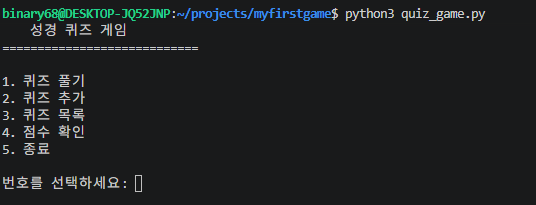

### 성경 퀴즈 문제 풀이 화면

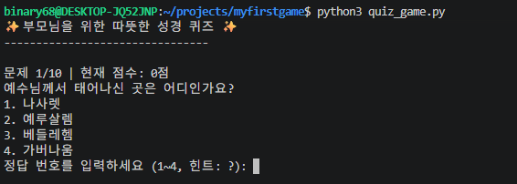

### 힌트 기능 실행 화면

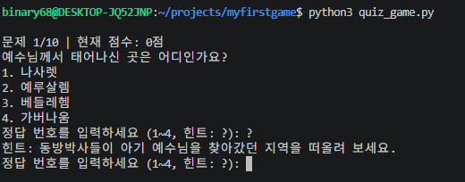

### 퀴즈 추가 화면

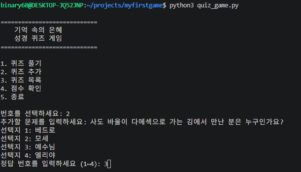

### 퀴즈 목록 화면

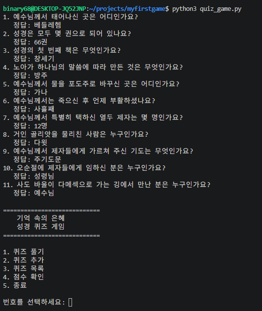

### 최고 점수 확인 화면

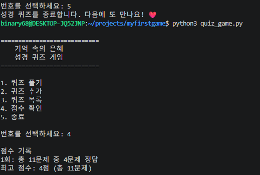

## 개발 환경 및 Git 작업 기록

### Git 커밋 기록 및 브랜치 병합

개발 과정에서 남긴 Git 커밋 기록과 브랜치 병합 내역입니다.

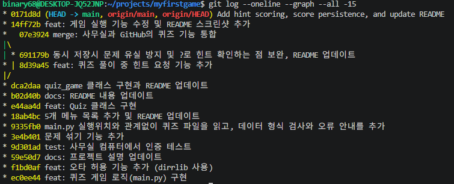

### VS Code 개발 환경과 Python 3.10.12

VS Code에서 프로젝트를 개발하는 화면과 Python 3.10.12 버전 확인 모습입니다.

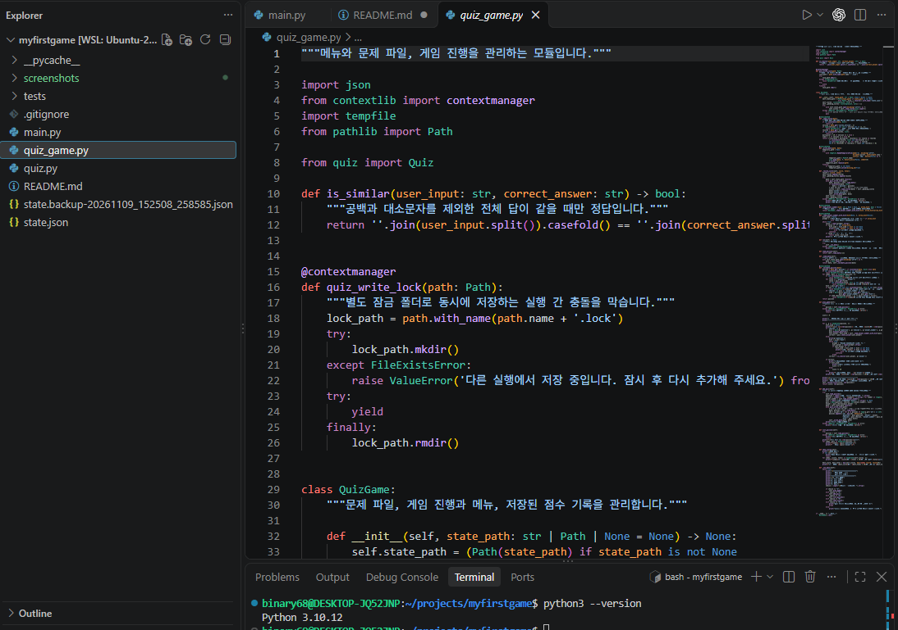

### Git 사용자 설정과 GitHub 저장소 연결

Git 사용자 설정과 프로젝트의 GitHub 원격 저장소 연결을 확인하는 화면입니다.

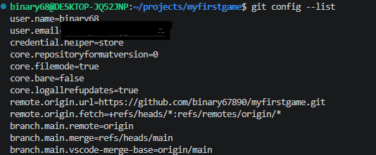

원격 저장소 URL 확인하는 화면입니다.
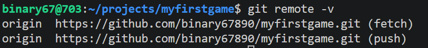

### 이 프로젝트는 모두 15개 이상의 커밋을 통해 단계적으로 개발되었습니다.
최근 15개 이상의 의미 있는 커밋 로그(git log)를 확인하는 화면입니다.
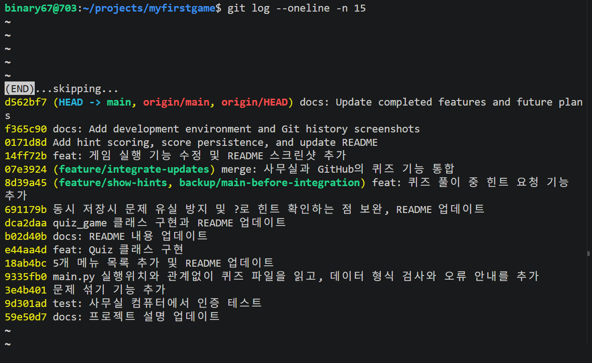

## 향후 업데이트 계획

- 더 많은 성경 문제 추가
- 게임 도중 메인 메뉴로 돌아가기
- 큰 글씨의 GUI 화면
