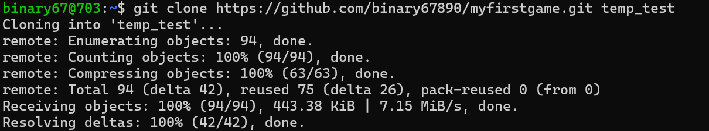
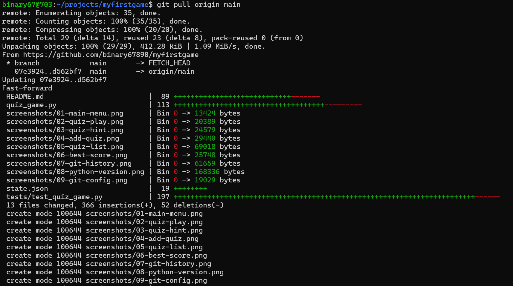

# 📖 기억 속의 은혜 — 성경 퀴즈 게임

부모님의 기억력 훈련을 돕고, 즐거운 시간을 보내실 수 있도록 만든 파이썬 퀴즈 게임입니다.

## 주요 기능

- ‘기억 속의 은혜’ 메뉴에서 퀴즈 풀기, 퀴즈 추가, 퀴즈 목록, 점수 확인, 종료를 선택합니다. 각 기능이 끝나면 메뉴로 돌아갑니다.
- 추가한 퀴즈와 완료한 게임의 점수 기록은 `state.json`에 저장합니다. 점수 기록과 최고 점수는 게임을 종료하고 다시 실행해도 유지됩니다.
- `state.json`의 모든 퀴즈를 저장된 순서대로 한 번씩 출제하며, 문제 번호와 현재 점수를 표시합니다.
- 객관식 문제는 선택지 번호(1~4)로 답합니다. 기존 주관식 문제는 공백(탭·줄바꿈 포함)과 대소문자를 무시한 전체 답이 같아야 정답입니다. `창세`는 `창세기`의 정답으로 인정하지 않으며, `엘리사`와 `엘리야`도 구분합니다.
- 객관식과 주관식 문제는 정답 입력 중 `?`를 입력하면 힌트를 확인할 수 있습니다. 힌트를 확인한 뒤 같은 문제에서 답을 입력하며, 정답을 맞히면 5점을 받습니다. 힌트 없이 맞히면 10점, 오답은 0점입니다.
- 정답과 오답에 격려 메시지를 표시하고, 마지막에 점수를 알려 줍니다.
- 데이터 파일을 읽을 수 없거나 형식이 잘못된 경우 오류를 안내합니다.

## 기본 제공 퀴즈

현재 저장소에 포함된 `state.json`의 `quizzes` 목록에는 성경 퀴즈 11개가 저장되어 있어, 과제에서 요구하는 최소 5문제 조건을 충족합니다. 프로그램 실행 후 메뉴 3번 ‘퀴즈 목록’을 선택하면 `퀴즈 목록 (총 11문제)` 표시로 문제 수를 확인할 수 있습니다. 문제를 추가하면 표시되는 수도 달라집니다.

## 실행 방법

1. Python 3.10 이상이 설치되어 있는지 확인합니다. 표준 라이브러리만 사용하므로 추가 패키지는 필요하지 않습니다.
2. 저장소를 내려받고 프로젝트 폴더로 이동합니다.
3. 다음 명령어로 실행합니다.

   ```bash
   python3 main.py
   ```

다른 폴더에서도 `main.py`의 경로를 지정하여 실행할 수 있습니다. 퀴즈 파일은 항상 `main.py`와 같은 폴더에서 읽습니다. `python3 quiz_game.py`로 직접 실행해도 같은 게임이 시작됩니다.

실행 후 아래 번호를 입력합니다.

1. 퀴즈 풀기
2. 퀴즈 추가
3. 퀴즈 목록 (정답 포함)
4. 점수 확인 (저장된 게임 기록과 최고 점수)
5. 종료

## 파일 구조

- `main.py`: `QuizGame`을 생성하고 메뉴를 실행하는 시작점
- `quiz_game.py`: 메뉴, 데이터 읽기·저장, 게임 진행, 점수 기록 저장·복원을 담당하는 `QuizGame` 클래스
- `quiz.py`: 객관식 문제 한 개를 관리하는 `Quiz` 클래스와 실행 예제
- `state.json`: 퀴즈 데이터와 점수 기록, 점수 형식 버전
- `tests/test_quiz_game.py`: 게임 진행, 저장, 오류 처리를 확인하는 자동 테스트
- `README.md`: 프로젝트 설명서

## 메뉴 사용 방법

| 번호 | 메뉴 | 사용 방법 |
| --- | --- | --- |
| 1 | 퀴즈 풀기 | 저장된 순서대로 모든 문제를 풀고 결과를 확인합니다. |
| 2 | 퀴즈 추가 | 문제, 선택지 4개, 정답 번호, 힌트를 입력합니다. 힌트는 Enter로 생략할 수 있습니다. |
| 3 | 퀴즈 목록 | 등록된 문제와 정답을 확인합니다. |
| 4 | 점수 확인 | 저장된 게임별 점수와 최고 점수, 각 기록의 만점을 확인합니다. |
| 5 | 종료 | 프로그램을 종료합니다. |

게임 중 `문제 1/10`처럼 진행 상황을 표시합니다. 힌트 없이 정답을 맞히면 10점, 힌트 사용 후 정답을 맞히면 5점, 오답은 0점입니다. 만점은 문제 수 × 10점으로, 10문제는 100점 만점이고 5문제는 50점 만점입니다. 현재 점수, 최종 점수와 점수 확인 화면에 실제 문제 수에 따른 만점을 함께 표시합니다. 답을 제출하면 정답 여부와 현재 점수를 알려 주고 다음 문제로 넘어갑니다. 모두 풀면 최종 점수와 격려 메시지가 나오며 메뉴로 돌아갑니다. 다시 시작하면 해당 게임의 점수는 0점부터 계산하고, 이전에 완료한 게임 기록은 `state.json`에 저장되어 재실행 후에도 유지됩니다. 최고 점수는 저장된 기록 중 가장 높은 점수이며, 해당 게임의 만점도 함께 표시합니다.

객관식과 주관식 퀴즈를 풀 때 정답 대신 `?`를 입력하면 해당 문제의 힌트를 확인할 수 있습니다. 힌트가 없으면 “이 문제에는 힌트가 없습니다.”라고 안내합니다. 힌트를 확인한 뒤 같은 문제의 정답을 다시 입력합니다. 같은 문제에서 힌트를 여러 번 확인해도 정답 점수는 5점으로 동일하며 문제 순서는 바뀌지 않습니다. 힌트가 없어 안내만 표시된 경우에는 감점하지 않습니다. 힌트 사용 여부는 문제마다 초기화됩니다. 이 기능은 퀴즈 풀이에서만 사용할 수 있으며, 퀴즈 추가 메뉴의 정답 번호 입력에서는 `?`를 잘못된 번호로 처리합니다.

정답 번호에 빈 문자열이나 1~4 이외의 값(퀴즈 풀이 중 `?` 제외)을 입력하면 같은 문제에서 다시 입력받습니다. 메뉴는 1~5를 입력합니다. Ctrl+C 또는 입력 종료 시에는 프로그램을 종료하며, 진행 중이던 게임은 점수 기록에 추가하지 않습니다.

## 퀴즈 데이터 형식

`state.json`은 다음과 같이 작성합니다. `quizzes` 안의 목록만 최상위에 작성하는 형식도 지원합니다.

```json
{
  "quizzes": [
    {
      "id": 7,
      "question": "성경의 첫 번째 책은 무엇인가요?",
      "answer": "창세기",
      "choices": ["출애굽기", "창세기", "레위기", "마태복음"],
      "answer_number": 2,
      "hint": "천지 창조 이야기가 나옵니다."
    }
  ]
}
```

문제는 하나 이상 있어야 하며, 각 문제의 `question`과 `answer`는 비어 있지 않은 문자열이어야 합니다. `id` 등의 추가 필드는 선택 사항입니다.

객관식 문제의 `choices`는 비어 있지 않은 문자열 4개, `answer_number`는 1~4 사이의 정수여야 합니다. `answer`에는 해당 선택지의 내용을 저장합니다. 예를 들어 `answer_number`가 `2`라면 두 번째 선택지와 `answer`가 같아야 합니다. `hint`는 생략하거나 `null`로 저장할 수 있으며, 지정한다면 비어 있지 않은 문자열이어야 합니다.

데이터의 `answer`는 정답 **내용**이고, `Quiz` 객체의 `answer`는 정답 **번호**입니다. `QuizGame`이 JSON의 `answer_number`를 `Quiz`의 `answer`로 전달합니다.

## Quiz 클래스

`quiz.py`의 `Quiz` 클래스는 문제와 선택지 4개를 묶어서 관리합니다. 문제 출력과 정답 확인을 담당하며, 메뉴나 점수 저장은 담당하지 않습니다.

`QuizGame`은 선택지가 있는 문제를 `Quiz` 클래스로 출력하고 채점합니다. 기존 주관식 데이터도 읽을 수 있지만, 메뉴에서 새로 추가하는 문제는 선택지 4개와 정답 번호를 입력하는 객관식입니다. `state.json`의 문자열 `answer`는 유지하며, 객관식 문제에는 `choices`, 정답 번호 `answer_number`, `hint`를 추가합니다. `answer_number`는 `Quiz`를 만들 때 `answer` 인자로 전달합니다.

현재 데이터는 4지선다 객관식이며, 실제 문제 수는 `state.json`의 `quizzes` 목록에 따라 달라집니다. 전체 게임은 `python3 main.py`로 실행하고 메뉴에서 `1`을 선택하세요. `python3 quiz.py`는 고정된 예제 한 문제만 실행합니다.

### 속성

| 속성 | 의미 | 조건 |
| --- | --- | --- |
| `question` | 문제 내용 | 비어 있지 않은 문자열 |
| `choices` | 선택지 목록 | 비어 있지 않은 문자열 4개 |
| `answer` | 정답 선택지 번호 | 1~4 사이의 정수 |
| `hint` | 문제 풀이 힌트 | 생략하면 `None`, 지정하면 비어 있지 않은 문자열 |

문제를 만들 때 위 조건에 맞지 않는 값을 전달하면 `ValueError`로 알려 줍니다.

### 메서드와 사용 예제

- `display_question()`: 문제와 1~4번 선택지를 출력합니다. 정답과 힌트는 자동으로 출력하지 않습니다.
- `check_answer(user_answer)`: 정답 번호와 비교하여 정답이면 `True`, 오답이나 잘못된 입력이면 `False`를 반환합니다. 정수 `2`와 입력 문자열 `"2"`를 모두 지원하며, 문자열 앞뒤 공백은 무시합니다.

```python
from quiz import Quiz

quiz = Quiz(
    question="성경의 첫 번째 책은 무엇인가요?",
    choices=["출애굽기", "창세기", "시편", "마태복음"],
    answer=2,
    hint="천지 창조 이야기가 나오는 책입니다.",
)

quiz.display_question()
print(quiz.hint)                # 필요한 경우 힌트를 직접 출력합니다.
print(quiz.check_answer("2"))    # True: 정답
print(quiz.check_answer(1))      # False: 오답
print(quiz.check_answer("abc"))  # False: 잘못된 입력
```

힌트가 필요하지 않으면 생성할 때 `hint` 항목을 생략하면 됩니다.

### 간단한 테스트 방법

프로젝트 폴더의 터미널에서 다음 명령어를 실행합니다.

```bash
python3 quiz.py
```

예제 문제와 선택지, 힌트가 표시됩니다. `2`를 입력하면 “정답입니다!”가 출력됩니다. 다시 실행하여 `1`이나 `abc`를 입력하면 오답 또는 잘못된 입력 안내가 출력되는지 확인할 수 있습니다. 이 실행은 `state.json`을 변경하지 않습니다.

예제는 `quiz.py`를 직접 실행할 때만 동작하며, `from quiz import Quiz`로 가져올 때는 실행되지 않습니다.

## QuizGame 클래스

`Quiz`가 문제 카드 한 장이라면 `QuizGame`은 카드들을 순서대로 보여 주는 진행자입니다. `main.py`에서 `QuizGame().run()`을 호출하여 실행합니다.

| 메서드 | 역할 |
| --- | --- |
| `run()` | 메뉴 실행 및 입력 종료·Ctrl+C 처리 |
| `load_quizzes()` | JSON 읽기와 문제 형식·정답 일치 검사 |
| `play_game()` | 각 문제를 한 번씩 출제하고 진행 번호·점수·최종 결과 표시 |
| `add_quiz()` | 문제, 선택지 4개, 정답 번호, 선택적 힌트를 입력받아 저장 |
| `list_quizzes()` | 등록된 문제와 정답 표시 |
| `show_scores()` | 저장된 게임의 점수 기록·최고 점수와 실제 만점 표시 |
| `read_answer_number(hint=None, allow_hint=False)` | 1~4 이외의 입력을 다시 안내하고, 풀이 중 `allow_hint=True`일 때만 `?`로 힌트 또는 힌트 없음 안내 표시 |

파일이 없거나 JSON이 손상되면 오류를 안내하고 메뉴로 돌아옵니다. 잘못된 정답 번호는 점수나 문제 순서를 바꾸지 않고 다시 입력받습니다. 입력이 중단된 게임은 완료 기록에 넣지 않습니다.

메뉴를 열거나 기록을 확인하는 것만으로는 기존 문제 파일을 변경하지 않습니다. 퀴즈를 완료하면 점수 기록을 저장하고 기존 문제는 보존합니다. 퀴즈 추가 시 기존 문제와 최고 점수 등 다른 JSON 항목을 보존합니다. 저장 직전에 최신 파일을 다시 읽어 입력 중 다른 실행에서 추가한 문제와 다른 JSON 항목도 보존합니다. 저장 구간은 `state.json.lock` 폴더로 잠그며, 저장이 겹치면 나중 실행은 오류 안내 후 메뉴로 돌아갑니다. 이때 입력한 문제는 저장되지 않으므로 다시 추가해야 합니다. 각 저장은 고유한 임시 파일에 쓴 뒤 원본을 교체합니다. 이 보호는 같은 저장 방식을 사용하는 게임 실행 간에 적용되며, 외부 편집기의 수정까지 잠그지는 않습니다.

저장 중 프로세스가 강제 종료되면 잠금 폴더가 남을 수 있습니다. 실행 중인 게임이 없는지 확인한 뒤 프로젝트 폴더의 빈 `state.json.lock` 폴더를 삭제하고 다시 실행하세요.

완료한 점수는 `state.json`의 `scores`에 `[점수, 전체 문제 수]` 형태로 저장하며, 새 형식은 `scores_version: 2`로 구분합니다. 게임 시작 시 기록을 불러오고, 점수 확인 메뉴에서 저장된 기록의 최댓값으로 최고 점수를 계산하므로 최고 점수도 재실행 후 유지됩니다. 별도의 최고 점수 필드는 사용하지 않습니다.

기존 1점 단위 기록(버전 없음 또는 버전 1)은 읽을 때 점수를 10배로 환산합니다. 다음 점수 저장 시 버전 2로 저장하여 중복 변환을 방지합니다. 과거 힌트 사용 여부는 기록되어 있지 않으므로 복원하지 않고 기존 점수만 환산합니다. 최상위가 문제 목록인 기존 파일은 점수 저장 시 `quizzes`와 `scores`를 포함한 객체 형식으로 변환하되 문제 내용을 보존합니다.

점수 기록이 없거나 잘못된 기록은 빈 기록으로 처리하거나 해당 항목을 건너뜁니다. 파일이 손상되어도 메뉴를 열 수 있으며, 문제를 읽을 때 오류를 안내합니다. 저장 실패 시 원본 파일을 보존하고 안내하며, 저장하지 못한 결과는 현재 실행에서 확인할 수 있습니다. 다음 퀴즈를 완료하면 저장을 재시도합니다.

### 테스트 실행

프로젝트 폴더에서 아래 명령어를 실행합니다. 자동 테스트는 실제 문제 데이터를 임시 폴더에 복사하여 사용하므로 원본 `state.json`을 변경하지 않습니다.

```bash
python3 -B -m unittest discover -s tests -v
```

자동 테스트 26개가 모두 통과했으며, 다음 동작을 확인합니다.

- 전체 문제를 순서대로 한 번씩 출제하고 정답·오답 점수를 계산하는지
- 잘못된 번호를 다시 입력받고, 새 게임의 점수를 초기화하는지
- 퀴즈 추가 후 새 문제를 출제하고 기존 문제·최고 점수 등 다른 데이터를 보존하는지
- 파일 누락, JSON 손상, 잘못된 문제 형식을 안내하고 메뉴로 돌아오는지
- 빈 선택지나 입력 중단 시 저장 또는 완료 기록을 남기지 않는지
- 저장에 실패해도 원본 파일을 유지하고 임시 파일과 잠금을 정리하는지
- 객관식·주관식 모두 힌트 없이 정답 10점, 힌트 사용 후 정답 5점, 오답 0점으로 채점하는지
- 힌트를 반복해서 확인해도 정답 점수는 5점이고, 다음 문제에서 힌트 사용 여부가 초기화되는지
- 객관식과 주관식에서 힌트가 생략되거나 `null`이면 안내 후 답을 다시 입력받는지
- 퀴즈 추가 메뉴에서는 `?`를 잘못된 정답 번호로 처리하는지
- 주관식에서 공백·대소문자를 제외한 전체 답만 정답으로 인정하는지
- 입력 중 다른 실행이 저장한 문제·메타데이터를 보존하고, 저장이 겹치면 원본을 유지하는지
- 최상위 목록 형식에서도 문제를 추가할 수 있는지
- 5문제는 50점, 10문제는 100점 만점으로 표시하는지
- 점수 기록과 최고 점수가 저장되고 재실행 후 복원되는지
- 이전 기록을 10배로 한 번만 변환하며 기존 문제와 다른 JSON 항목을 보존하는지
- 점수 저장 실패 후 재시도하고, 게임 도중 파일이 손상되거나 지원하지 않는 점수 버전이면 원본을 덮어쓰지 않는지

실행 결과는 마지막에 `Ran 26 tests`와 `OK`로 표시됩니다.

## 프로그램 유지보수 가이드

아래는 현재 구현에서 변경 영향을 확인할 위치입니다. 데이터 필드의 의미와 클래스 사용법은 앞의 설명을 참고하고, 변경 시에는 호출하는 쪽과 저장된 데이터의 호환성을 함께 확인합니다.

### 변경 목적별 확인 위치

| 변경 작업 | 확인할 파일과 함수 | 함께 확인할 사항 |
| --- | --- | --- |
| 점수 계산 방식 | `quiz_game.py`: `QuizGame.play_game()`, `_read_answer_number_with_hint()`, `_record_score()`, `_read_scores()`, `show_scores()`, `__init__()` | 정답·오답·힌트 사용 점수와 만점 표시를 함께 수정합니다. 현재 만점 계산의 `10`은 여러 출력 위치와 점수 유효성 검사에 사용됩니다. 저장 점수의 단위나 형식을 바꾸면 기존 기록 환산과 `scores_version` 처리도 검토합니다. |
| `Quiz`의 문제 구조·객관식 정답 처리 | `quiz.py`: `Quiz.__init__()`, `display_question()`, `check_answer()`; `quiz_game.py`: `QuizGame._validate_quizzes()`, `add_quiz()`, `play_game()`, `read_answer_number()`, `_read_answer_number_with_hint()`, `list_quizzes()` | 선택지 수·번호 범위·출력·입력·검증을 함께 확인합니다. JSON의 `answer`는 정답 내용이고 `Quiz.answer`는 번호이므로 대응을 유지합니다. 주관식 비교 규칙은 `quiz_game.py`의 `is_similar()`와 `play_game()`의 주관식 분기를 확인합니다. `quiz.py` 직접 실행 예제도 새 구조와 맞춥니다. |
| 데이터 구조·저장 방식 | `quiz_game.py`: `QuizGame.__init__()`, `load_quizzes()`, `_load_data()`, `_validate_quizzes()`, `_read_scores()`, `_write_data()`, `add_quiz()`, `_record_score()` 및 모듈 함수 `quiz_write_lock()` | `state.json`의 기존 객체·최상위 목록 형식, 점수 버전과 다른 JSON 항목 보존을 검토합니다. 퀴즈 추가와 점수 저장 양쪽에서 최신 데이터 재읽기·잠금·실패 처리가 유지되어야 합니다. 성능 측정 데이터도 `benchmark_quiz.py`의 `make_data()`와 `main()`에서 실제 형식·저장 경로에 맞는지 확인합니다. |
| 메뉴 추가·수정 | `quiz_game.py`: `QuizGame._run_menu()`, `run()`; 기존 연결 대상인 `play_game()`, `add_quiz()`, `list_quizzes()`, `show_scores()`; `main.py`: `main()` | 출력 번호·입력 분기·잘못된 번호 안내를 함께 맞춥니다. 작업 후 메뉴 복귀, 종료, EOF·Ctrl+C 처리를 확인합니다. 시작점은 `main()` → `QuizGame().run()`이며, 새 메뉴는 구현한 처리 함수에 연결해야 합니다. README의 메뉴 안내도 갱신합니다. |

### 관련 테스트와 실행 방법

현재 자동 테스트는 `tests/test_quiz_game.py`의 `QuizGameTests`에 있습니다. `setUp()`은 실제 문제 파일을 임시 디렉터리에 복사하고, `run_menu()`는 입력과 출력을 대체하여 메뉴를 실행합니다. 아래는 변경별로 우선 확인할 기존 테스트의 예시이며, 변경한 동작에 맞는 검증을 보완한 뒤 전체 테스트도 실행합니다.

| 변경 작업 | 관련 테스트 메서드 (`tests/test_quiz_game.py`) |
| --- | --- |
| 점수 계산 | `test_hint_scoring_matrix_for_choice_and_subjective_questions`, `test_full_score_uses_actual_question_count`, `test_repeated_hint_makes_correct_answer_worth_five`, `test_legacy_migration_is_applied_once_and_preserves_data`, `test_new_score_version_validates_against_ten_points_per_question` |
| 문제 구조·정답 처리 | `test_order_scoring_retry_and_second_game`, `test_add_preserves_existing_data_and_can_play_new_question`, `test_blank_choice_does_not_save`, `test_subjective_requires_full_answer_and_supports_hint` |
| 데이터 구조·저장 | `test_list_format_can_add_quiz`, `test_score_save_preserves_latest_data_and_handles_list_format`, `test_save_failure_keeps_original`, `test_overlapping_save_is_rejected_without_modifying_file`, `test_corruption_during_game_does_not_overwrite_file`, `test_scores_persist_and_highest_is_shown_after_restart` |
| 메뉴·오류·중단 | `test_order_scoring_retry_and_second_game`, `test_missing_corrupt_and_invalid_files_return_to_menu`, `test_interrupted_input_does_not_record_or_save` |

프로젝트 폴더에서 실행합니다. 전체 테스트 명령과 검증 범위는 앞의 ‘테스트 실행’ 절을 참고하세요.

```bash
# 특정 점수 테스트만 실행하는 예
python3 -B -m unittest discover -s tests -p test_quiz_game.py -k test_hint_scoring_matrix_for_choice_and_subjective_questions -v
# 변경 후 전체 회귀 테스트
python3 -B -m unittest discover -s tests -v
```

`Quiz` 전용 자동 테스트 파일은 현재 없습니다. 기존 게임 테스트를 통한 검증 외에 `python3 -B quiz.py`로 직접 실행 예제를 확인할 수 있으며, 이는 전체 회귀 테스트를 대신하지 않습니다. 새 메뉴나 새 정답 규칙의 검증은 기존 테스트가 자동으로 보장하지 않으므로 관련 테스트를 추가해야 합니다. 수동으로 문제 추가·게임 완료를 확인할 때도 실제 기록 대신 임시 파일을 지정한 `QuizGame(state_path=...)`을 사용합니다.

### 유지보수 점검표

- [ ] 수정 전 `git status`와 `git diff`로 기존 작업을 확인하고 변경 목적·영향 범위를 정합니다.
- [ ] 게임을 종료하고 아래 ‘데이터 백업 및 복구 방법’에 따라 정상 `state.json` 전체를 백업합니다. 백업에는 문제뿐 아니라 점수 기록도 포함합니다.
- [ ] 위 표의 호출부·검증·출력·저장 경로를 함께 확인하고 필요한 범위만 수정합니다. 데이터 형식 변경 시 기존 파일을 읽는 호환성도 검증합니다.
- [ ] 관련 테스트를 보완·실행하고 전체 회귀 테스트 결과를 확인합니다. 저장 실패·파일 손상·중단·동시 저장 검증은 임시 파일에서 수행합니다.
- [ ] 메뉴·점수·문제 수와 저장 후 재실행 결과를 임시 데이터로 확인하고, 동작이 바뀐 README 설명도 갱신합니다. 규모나 저장 방식 변경 시 ‘임시 파일 벤치마크’도 다시 수행합니다.
- [ ] 실제 `state.json`과 기존 점수가 의도치 않게 바뀌지 않았는지, 임시 데이터·개인 백업이 커밋 대상에 포함되지 않았는지 확인합니다.
- [ ] 아래 ‘Git 커밋 규칙’에 따라 변경 내용과 테스트 결과를 최종 검토하고, 의도한 파일만 스테이징하여 한 목적의 커밋으로 기록합니다.

## 데이터 백업 및 복구 방법

### 파일 손상·삭제 시 영향

`state.json`이 삭제되거나 JSON 문법·문자 인코딩이 손상되어 읽을 수 없으면 메뉴는 열리지만 퀴즈 풀기와 목록 확인 시 “퀴즈 데이터를 불러올 수 없습니다”, 퀴즈 추가 시 “퀴즈를 추가할 수 없습니다”라는 오류를 안내하고 메뉴로 돌아옵니다. JSON 문법이 정상이어도 문제 형식이 잘못되면 검증에 실패합니다. 파일이 없는 경우 기본 11문제를 자동 생성하지 않습니다.

시작 시 파일을 읽지 못하면 점수 기록은 빈 목록으로 시작합니다. 이미 실행 중인 프로그램에는 이전에 읽은 점수가 남아 있을 수 있으므로, 화면에 점수가 보인다는 사실만으로 파일이 정상이라고 판단하면 안 됩니다. 게임 도중 파일 문제가 발생하여 점수 저장에 실패하면 해당 결과는 현재 실행에서만 확인할 수 있고, 저장 전에 종료하면 사라집니다. 잘못된 점수 항목은 건너뛰거나 빈 기록으로 처리하므로 퀴즈 목록이 정상이어도 점수 기록은 별도로 확인해야 합니다.

### 현재 구현된 보호 기능과 범위

앞의 `QuizGame 클래스` 절에 설명한 전체 데이터 재읽기·문제 검증, `state.json.lock` 잠금, 같은 폴더의 고유 임시 파일에 쓴 뒤 원본 교체, 저장 오류 안내가 구현되어 있습니다. 교체 전 읽기·쓰기 실패 시 기존 파일을 덮어쓰지 않으며, 일반적인 예외 처리에서는 임시 파일과 잠금을 정리합니다. 점수 저장은 점수 버전도 검사합니다. 강제 종료로 남은 잠금 처리 방법도 해당 절을 참고하세요.

**자동 백업과 자동 복구 기능은 없습니다.** 저장용 임시 파일은 이전 데이터를 보관하는 백업이 아닙니다. 직접 편집으로 인한 손상, 파일 삭제, 저장 장치 고장이나 전원 차단까지 복구해 주지는 않습니다. `fsync()`를 통한 영구 반영 보장도 없으므로 정상 백업본을 따로 보관해야 합니다.

### 수동 백업 만들기

아래 명령은 프로젝트 폴더에서 실행하는 Bash 예시입니다. 파일 이름의 날짜와 번호는 백업할 때마다 바꾸세요.

1. 모든 게임 실행을 종료합니다. 메뉴 3번과 4번에서 문제·점수 기록이 정상인지 확인한 뒤 종료한 파일을 백업합니다.
2. 다음 명령으로 **파일 전체**를 복사합니다. `-i` 옵션이 기존 백업을 덮어쓸지 물으면 기존 파일을 보존하고 새 이름을 사용하세요.

   ```bash
   mkdir -p backups
   cp -i state.json backups/state-2026-11-14-01.json
   cmp state.json backups/state-2026-11-14-01.json
   ```

   `cmp`가 출력 없이 정상 종료하면 두 파일의 내용이 같습니다. 오류가 나오면 복사 성공 여부를 확인하세요. `quizzes`만 복사하면 점수가 빠지므로 `scores`, `scores_version` 및 다른 항목까지 포함한 파일 전체를 보관합니다.
3. 백업을 별도 저장 장치에도 복사합니다. 같은 디스크의 백업만으로는 디스크 고장에 대비할 수 없습니다. 손상을 발견한 파일로 정상 백업을 덮어쓰지 마세요.

### 백업본으로 복원하기

1. 실행 중인 게임을 모두 종료합니다. 실행 중 복원하면 메모리에 남은 점수와 복원한 파일이 달라지거나 이후 저장이 복원 파일을 변경할 수 있습니다.
2. 손상된 `state.json`이 남아 있다면 원인 확인을 위해 별도 이름으로 복사합니다. 파일이 삭제된 경우 이 단계는 생략합니다. 아래 이름도 기존 파일과 겹치지 않게 바꾸세요.

   ```bash
   cp -i state.json backups/state-damaged-2026-11-14-01.json
   ```

3. 사용할 정상 백업의 JSON 문법과 문제 형식을 읽기 전용으로 확인합니다. 아래 명령은 백업을 수정하지 않습니다. 실패하면 복원을 진행하지 말고 다른 정상 백업을 선택합니다.

   ```bash
   python3 -B -m json.tool backups/state-2026-11-14-01.json > /dev/null
   python3 -B -c 'from quiz_game import QuizGame; game = QuizGame("backups/state-2026-11-14-01.json"); print("백업 문제 수:", len(game.load_quizzes()))'
   ```

   이 확인만으로 모든 점수 기록의 유효성까지 보장하지는 않습니다. 점수는 복원 후 메뉴에서 백업 당시 기록과 비교합니다.
4. 정상 백업을 `main.py`와 같은 폴더의 `state.json`으로 복사하고 내용이 같은지 확인합니다. 덮어쓰기 확인에는 복원할 파일과 백업 이름을 확인한 뒤 답합니다.

   ```bash
   cp -i backups/state-2026-11-14-01.json state.json
   cmp backups/state-2026-11-14-01.json state.json
   ```

5. `python3 main.py`로 **새로 실행**합니다. 메뉴 3번 ‘퀴즈 목록’에서 총 문제 수·문제·정답을 확인하고, 메뉴 4번 ‘점수 확인’에서 게임별 점수·만점·최고 점수를 백업 당시와 비교합니다. 백업에 점수가 없었다면 빈 기록 안내가 정상입니다. 기존 점수 형식의 환산 규칙은 앞의 점수 저장 설명을 참고하세요. 확인만 할 때는 메뉴 1번의 게임 완료나 메뉴 2번의 문제 추가를 하지 말고 메뉴 5번으로 종료합니다.

복구 범위는 백업을 만든 시점까지입니다. 그 이후 추가한 문제나 점수는 해당 백업으로 복구할 수 없습니다. 정상 백업이 없다면 자동 복구할 수 없으며, 저장소에 포함된 원본 파일을 다시 가져와도 개인적으로 추가한 문제와 점수까지 돌아오지는 않습니다.

향후에는 저장 전 정상 파일의 날짜별 자동 백업, 백업 검증과 보관 개수 제한, 복구할 버전을 선택하는 기능을 추가할 수 있습니다. 현재는 구현되지 않은 개선안입니다.

## 데이터 규모에 따른 성능 분석

### 시간 복잡도와 메모리 사용

문제 수를 n, 점수 기록 수를 s, 점수·메타데이터까지 포함한 JSON 전체 크기를 B라고 합니다. 아래 복잡도는 코드에 대한 이론적 분석이며 실측 시간이 아닙니다. 문제별 문자열 길이와 메타데이터 크기가 일정할 때 B는 대략 n + s에 비례합니다.

| 작업 | 시간 복잡도 | 메모리 특성 |
| --- | --- | --- |
| 퀴즈 읽기 | `load_quizzes()` → `_load_data()`에서 `json.load()`로 전체 파일을 읽고 모든 문제를 검증하므로 O(B) | 전체 JSON 문자열과 파싱한 객체가 메모리에 올라가 최대 O(B). 검증 중 `Quiz`와 선택지 복사본은 문제마다 잠깐 생성됩니다. |
| 목록 출력 | 전체 읽기·검증 후 n개 문제와 정답을 순회하므로 O(B + 출력 문자 수) | 읽어 둔 데이터 O(B). 출력 문자열은 한 줄씩 만들며, 터미널이나 출력 수집기의 별도 버퍼는 환경에 따라 달라집니다. |
| 문제 검색 | 현재 검색 메뉴나 ID·키워드 검색 함수는 없습니다. 목록을 순회하는 검색을 추가한다면 최악 n개를 비교합니다. | 선형 검색의 추가 메모리는 첫 결과만 찾을 때 O(1), 결과 k개를 목록으로 모으면 O(k). 이는 개선 검토용 분석이며 현재 구현이나 실측 결과가 아닙니다. |
| 퀴즈 추가·저장 | 입력 전 전체 읽기와 저장 직전 재읽기·검증, ID 목록 생성·최댓값 확인 O(n), 전체 JSON 쓰기 O(B). 전체는 O(B + n) | 전체 데이터 O(B)에 정수 ID 목록 O(n)이 추가됩니다. 임시 파일로 직렬화하므로 디스크에는 교체 전 원본과 새 파일이 함께 존재합니다. |
| 점수 저장 | `_record_score()`도 전체 재읽기·검증, 점수 목록 처리 O(s), 전체 쓰기를 하므로 O(B + s) | 전체 데이터 O(B)와 점수 목록 O(s). 문제를 바꾸지 않아도 전체 파일을 다시 씁니다. |

문제 ID를 딕셔너리 항목으로 보관하는 것만으로 문제 목록 검색이 빨라지지는 않습니다. 향후 선형 ID 검색은 항목당 비교 비용이 일정하면 O(n), 키워드 검색은 문제 문자열 길이와 검색어 길이에 따른 비교 비용도 포함해야 합니다. 생성자 역시 점수 복원을 위해 전체 JSON을 파싱하므로 시작 비용은 O(B + s)입니다. `json.dump()`는 직렬화 결과 전체를 별도 문자열로 만들지 않고 조각을 쓰지만, 원본 데이터 객체는 계속 메모리에 유지됩니다. 잠금과 임시 파일 교체 방식은 앞의 `QuizGame 클래스` 절에 설명되어 있습니다.

### 임시 파일 벤치마크

재현 명령은 다음과 같습니다. Python 표준 라이브러리만 사용하며 게임 기능을 바꾸지 않습니다.

```bash
python3 -B benchmark_quiz.py
```

측정 환경(2026-11-14): Python 3.10.12, Linux 6.18.58.1-microsoft-standard-WSL2, x86_64, Intel Core i5-1145G7 @ 2.60GHz(논리 CPU 8개), `/tmp`의 ext4 파일시스템입니다. 하드웨어 정보는 실행 환경이 보고한 값입니다.

`benchmark_quiz.py`는 성경 질문 3종을 반복하고 번호·ID를 다르게 붙여, 선택지 4개·정답·힌트가 있는 유효한 퀴즈를 각각 1,000개와 10,000개 생성합니다. 서로 다른 내용의 문제 10,000종을 모은 데이터는 아닙니다. 점수 기록은 버전 2의 임시 기록 1개로 고정합니다. 생성과 초기 저장, `QuizGame` 생성자 실행은 측정에서 제외합니다.

- 읽기: 실제 `load_quizzes()`의 파일 열기, JSON 파싱, 전체 문제 검증, 반환 객체 해제까지 측정합니다.
- 저장: 실제 `quiz_write_lock()`으로 잠그고 `_load_data()`로 재읽기·검증한 뒤 `_write_data()`로 같은 데이터를 전체 저장합니다. 임시 파일 생성·닫기·교체와 잠금 정리를 포함합니다. 사용자 입력, 새 문제 추가 및 ID 계산, 점수 병합은 포함하지 않습니다.
- 각 작업은 워밍업 1회 후 `time.perf_counter()`로 7회 측정하여 중앙값과 최솟값~최댓값을 표시합니다. 각 회차 직전 `gc.collect()`는 시간에서 제외합니다.
- 메모리는 시간 측정과 분리한 추가 1회 실행에서 `tracemalloc`으로 측정한 Python 할당의 최대치입니다. 프로세스 전체 메모리(RSS), OS 파일 캐시, 데이터 생성 시 메모리는 포함하지 않습니다. 1 MiB는 1,048,576바이트입니다.

아래 수치는 이 환경에서 **실제로 측정한 결과**입니다.

| 문제 수 | JSON 파일 크기(바이트) | 읽기 중앙값 ms (최소~최대) | 저장 중앙값 ms (최소~최대) | 읽기 최대 할당 MiB | 저장 최대 할당 MiB |
| --- | --- | --- | --- | --- | --- |
| 1,000 | 407,581 | 4.739 (4.379~6.147) | 21.473 (20.306~22.715) | 1.681 | 1.682 |
| 10,000 | 4,094,583 | 52.231 (49.643~54.602) | 253.034 (221.351~298.548) | 16.849 | 16.850 |

모든 쓰기는 `TemporaryDirectory` 안의 파일에만 수행하고 종료 시 정리합니다. 실제 `state.json`은 전후 SHA-256 확인을 위한 읽기만 수행하며, 두 해시 모두 `ba9a7c42862b5f2176cdb76ee15a3f6dee34ab92e3a63da4c4d718bf505f18f8`로 같았습니다. 따라서 기존 문제와 점수 기록의 바이트 내용이 보존되었음을 확인했습니다.

측정 한계: 워밍업과 반복 실행으로 OS 캐시의 영향을 받으며, 저장은 `fsync()`를 호출하지 않으므로 물리 디스크에 영구 반영되는 시간까지 측정하지 않습니다. CPU 부하, WSL 환경, 저장 장치, 긴 문자열과 점수 기록 증가에 따라 결과가 달라집니다. 목록의 터미널 출력, 검색, 동시 저장 충돌, 최초 실행의 캐시 없는 읽기는 측정하지 않았습니다. 실측한 두 규모 밖의 시간·메모리 수치를 추정해 제시하지 않으며, 복잡도만으로 정확한 시간을 보장할 수 없습니다.

### 데이터 증가 시 개선 방안

- 목록은 페이지 단위로 표시해 출력량을 줄일 수 있습니다. 다만 JSON 전체 읽기를 유지하면 읽기 시간과 메모리 자체는 줄지 않습니다.
- 읽은 데이터를 캐시하고 파일 변경 시 무효화하면 반복 파싱을 줄일 수 있습니다. 다른 실행의 변경을 보존하려면 저장 직전 재확인 원칙도 함께 유지해야 합니다.
- ID 기반 반복 검색은 별도 딕셔너리 인덱스를 만들면 구축 O(n), 추가 메모리 O(n)으로 평균 O(1) 조회를 기대할 수 있습니다. 키워드 부분 검색은 별도 검색 구조를 검토해야 합니다. 이는 이론적 기대이며 성능은 측정하지 않았습니다.
- 표준 라이브러리 `sqlite3`로 문제와 점수 기록을 나누어 저장하면 필요한 행만 읽거나 갱신하고 트랜잭션으로 동시 변경을 관리할 수 있습니다. ID 인덱스와 페이지 조회를 함께 설계하고, 실제 데이터로 재측정해야 합니다.
- JSON을 유지한다면 문제와 누적 점수 기록의 파일 분리로 점수 저장 때 문제 전체를 다시 쓰는 비용을 줄일 수 있습니다. 파일 간 일관성과 장애 복구 설계가 필요합니다.

이 개선안은 제안이며 현재 프로그램에는 적용하지 않았습니다.

## 게임 실행 화면

### 메인 메뉴 화면


### 성경 퀴즈 문제 풀이 화면


### 힌트 기능 실행 화면


### 퀴즈 추가 화면


### 퀴즈 목록 화면


### 최고 점수 확인 화면


## Git 커밋 규칙

하나의 커밋에는 가급적 하나의 목적을 가진 변경 사항을 묶습니다. 커밋 메시지는 `유형: 변경 내용` 형식으로 작성하며, 변경 내용을 간결하고 구체적으로 설명합니다.

| 유형 | 의미 | 메시지 예시 |
| --- | --- | --- |
| `feat` | 기능 추가 | `feat: 퀴즈 검색 기능 추가` |
| `fix` | 오류 수정 | `fix: 잘못된 정답 번호 처리 오류 수정` |
| `docs` | 문서 수정 | `docs: 실행 방법 설명 보완` |
| `test` | 테스트 수정 | `test: 힌트 사용 후 채점 테스트 보완` |
| `refactor` | 구조 개선 | `refactor: 퀴즈 입력 처리 함수 분리` |
| `ci` | CI 설정 변경 | `ci: 자동 테스트 실행 설정 추가` |

위 표는 작성 형식 예시이며, 실제 `git log`에서 확인한 커밋 메시지는 다음과 같습니다.

- `feat: Quiz 클래스 구현`
- `feat: 퀴즈 풀이 중 힌트 요청 기능 추가`
- `docs: README에 Git 실습 안내 추가`

커밋 전에는 `git status`와 `git diff`로 변경 파일과 내용을 확인하고, 커밋에 포함할 변경은 `git diff --staged`로 다시 확인합니다. 코드 변경 시에는 위의 ‘테스트 실행’ 절에 따라 테스트를 실행하고 결과를 확인합니다. 문서만 수정한 경우에도 변경 내용과 관련된 기존 테스트 결과를 확인하고, 테스트 실행 여부를 구분하여 기록합니다.

## 개발 환경 및 Git 작업 기록

### Git 커밋 기록 및 브랜치 병합

개발 과정에서 남긴 Git 커밋 기록과 브랜치 병합 내역입니다.


### VS Code 개발 환경과 Python 3.10.12

VS Code에서 프로젝트를 개발하는 화면과 Python 3.10.12 버전 확인 모습입니다.


### Git 사용자 설정과 GitHub 저장소 연결

Git 사용자 설정과 프로젝트의 GitHub 원격 저장소 연결을 확인하는 화면입니다.


원격 저장소 URL 확인하는 화면입니다.


### 이 프로젝트는 모두 15개 이상의 커밋을 통해 단계적으로 개발되었습니다.
최근 15개 이상의 의미 있는 커밋 로그(git log)를 확인하는 화면입니다.


## 🔄 Git 협업 및 동기화 실습 기록

본 프로젝트는 여러 환경(집, 사무실 등)에서의 작업 연속성을 위해 Git의 원격 저장소 기능을 활용하였습니다.

### 1. 사용된 주요 명령어
- `git clone <URL>`: 원격 저장소의 프로젝트를 로컬 PC로 최초 복제
- `git pull origin main`: 다른 환경에서 작업하여 업데이트된 최신 코드를 로컬로 가져오기
- `git add / commit / push`: 로컬의 변경 사항을 원격 저장소에 반영

### 2. 동기화 시나리오
1. **사무실 PC**: 초기 코드 작성 및 `push`
2. **집 PC**: `git clone`을 통해 프로젝트 복제 및 문제 추가 작업 후 `push`


3. **사무실 PC**: `git pull` 명령어로 집에서 작업한 최신 내용을 반영하여 개발 지속



## 향후 업데이트 계획

- 더 많은 성경 문제 추가
- 게임 도중 메인 메뉴로 돌아가기
- 큰 글씨의 GUI 화면
